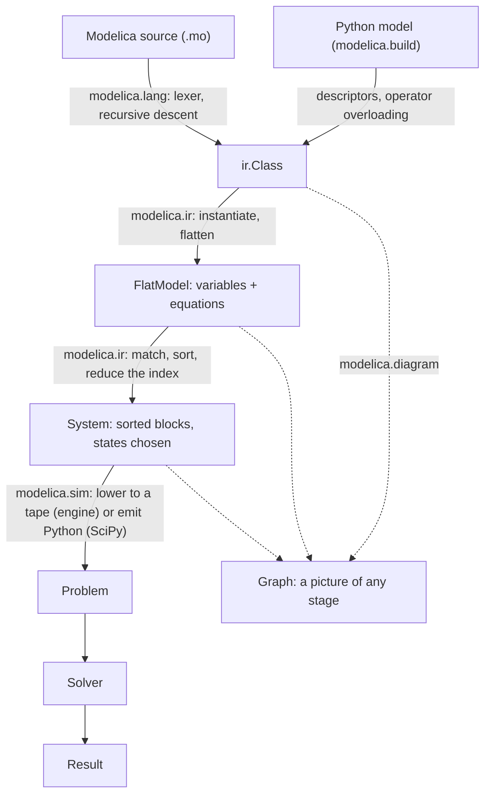

# Architecture

One rule shapes this rewrite: **every stage is a value you can hold.**

Parsing returns an AST. Flattening returns a flat model. Causalization returns a sorted
block structure. Simulation returns trajectories. Each one is an ordinary Python object
that you can print, compare and change. None of them is state hidden inside a compiler.

The 2010 prototype failed in the other direction. Its grammar was written in pyparsing, so
the grammar *was* the program. Nothing existed between "source" and "result" that a person
could look at.

## The pipeline



Two exchange formats cross the pipeline.

* **FMI 3.0** (`modelica.fmi`) attaches at both ends. It reads an FMU that another tool
  compiled and simulates it through the same `Problem` and `Solver`. It also exports a
  `System` as an FMU.
* **SSP 2.0** (`modelica.ssp`) sits above. A `.ssp` file names components, which are
  usually FMUs, and wires them together. A co-simulation master then steps several
  `Problem`s at once.

## Two front ends, one IR

A model arrives as a `.mo` file, or as Python. `modelica.build` is **not** a wrapper that
writes Modelica text and parses it back. It is a peer of `modelica.lang`, and it builds
`modelica.ir` values directly. Both roads end at the same `ir.Class`. Everything below —
flattening, index reduction, code generation, FMU export — sees only that.

```python
class NewtonCooling(Model):
    """A hot object cooling toward ambient"""

    k = parameter(Real, 0.5, unit="1/s", doc="Cooling coefficient")
    T = Real(unit="degC", start=90, fixed=True, doc="Object temperature")

    def equations(self):
        yield der(self.T) == -self.k * self.T
```

Four mappings carry the whole front end:

* A declaration is a **descriptor**, so `self.T` reads as a reference and no instance has
  to exist.
* `==` builds an **equation** and not a bool. Modelica's `=` is acausal, so this is the
  honest reading of it.
* Python inheritance is **`extends`**.
* A Python module is a **`package`**.

The acceptance test compares values, not text. Every example in `examples/` is written
twice, once per front end, and the pair must flatten to the same `FlatModel`.

Why have a second front end at all? Modelica text is the interchange format. But a model
that is *generated* wants to be a Python value: a model swept over parameters, or assembled
from a topology, or built inside a notebook. The two front ends are peers, and neither can
quietly become the poor relation.

## Performance: where the time goes

The default simulation path is now the [precompiled engine](vm/index.md): a Rust virtual
machine that runs Radau and interprets the model as bytecode. This section explains the SciPy
path, which remains the fallback where no engine is installed.

The goal was a Python engine that stands next to LSODA, DASSL, RADAU5 and CVODE. That is
possible, because a stiff solver spends almost none of its time in the parts written in
Python.

The work splits in two.

* **Control.** Step size and order selection, error norms, the Newton loop, event location,
  and the rules for reusing a Jacobian. This runs once per step, on scalars and small
  arrays. Python is fast enough here. SciPy's `Radau` and `BDF` are pure Python and NumPy,
  and they are used in production every day.
* **Kernel.** The residual or right-hand side, the Jacobian, and the linear solve. This
  runs several times per step, and it dominates.

The largest factor is the algorithm, not the language. On Robertson, an explicit method
needs 10⁷ to 10⁸ steps and a good stiff method needs a few hundred. That ratio of about 10⁶
does not depend on the implementation language at all. Correct order control, correct step
size control and correct index reduction buy more than any micro-optimisation. If you get
them wrong, no amount of C in the inner loop recovers it.

What is left is the cost of one step. The engine pays it with a precompiled VM.

> **The IR lowers to straight-line arithmetic.** The engine (`modelica.sim.vm`) lowers the
> right-hand side, the Jacobian and the event indicators to a register tape. The SciPy path
> emits the same arithmetic as Python. Neither walks a tree of closures at every evaluation,
> and nothing is compiled per model.

This is a constraint on the design of the IR, which is why it is recorded here and not in a
tuning note later. The expression IR is small, typed, closed under symbolic
differentiation, and free of any Python object that cannot be written as arithmetic. An
interpreter over the same IR stays as the reference implementation. It is what the engine is
tested against.

The other design — a tree of closures walked from Python — is 10 to 100 times slower. No
amount of solver quality hides that.

### Matching the Fortran codes is the floor

The engine owns the model, so it can do two things a black-box integrator cannot.

* **Differentiate the model.** The equations are held symbolically, so an analytic and
  sparse Jacobian is free. Its pattern comes from the incidence matching. A black-box
  integrator uses finite differences: *n* extra evaluations per Jacobian.
* **Make the system smaller before the solver sees it.** Tearing and BLT turn a block of *n*
  equations into a smaller torn system inside a sequence of assignments.

The claim is only worth making against a fixed harness. [Benchmarks](ideas/benchmarks.md)
records which problem sets that means.

## The layers

### `modelica.lang` — source to AST

A lexer and a recursive-descent parser, both written by hand, against the Modelica Language
Specification 3.x grammar. There is no parser generator and no pyparsing. The grammar is
stable and small enough to write out. Only a hand-written parser gives a usable error:
"expected `end <name>;` at 12:5, to close `model Foo` opened at 3:1".

Every token carries a line and a column, and the nodes an error can point at carry them on
after the parser has finished: a reference, an equation and a component each hold an
optional `ir.Span`. It is excluded from equality and from hashing, which is what lets the
same model built from Python -- where there is no source text and every span is `None` --
still compare equal to the one read from a `.mo`. Literals and operators carry none: a span
is there to be *reported*, and no message names an addition.

### `modelica.build` — Python to IR

Descriptors, operator overloading and a metaclass, and nothing else. Every value in the
module is a frozen dataclass. `flow(...)`, `parameter(...)` and the rest return a *new*
declaration instead of changing one, so a builder expression means the same thing wherever
it appears. The module changes exactly one thing in place: `__set_name__`. That is
unavoidable, because a descriptor learns its own name only after it exists.

One rule of Python shaped the design, and it is worth stating.

Rich comparison gives priority to the *right* operand when its type is a proper subclass of
the left one. The numeric operators guard against this and the comparison operators do not.
If `Declaration` had subclassed `Expression`, then `der(self.h) == self.v` would have run
`self.v.__eq__` and produced `v = der(h)`. That is the same equation acausally, but not the
same text, and the mismatch would have had no visible cause. So `Declaration` is a
descriptor that *returns* an `Expression`. The design removes the possibility instead of
documenting it.

### `modelica.ir` — AST to a solvable system

This is the interesting layer, and the whole project stands on it.

* **Flattening** resolves `extends`, expands components and `for` equations, applies
  modifications, and turns `connect()` into its potential and flow equations. It produces a
  `FlatModel`: typed variables and scalar equations over an expression IR.
* **The expression IR** is separate from the AST on purpose. The AST mirrors what the
  modeller wrote. The IR is what gets differentiated and evaluated, so it is small, typed
  and closed under symbolic differentiation.
* **Matching and BLT** first match equations to unknowns in a bipartite graph, then run
  Tarjan's algorithm to get block-lower-triangular form. That says which equations must be
  solved together, and which are a plain sequence of assignments.
* **Index reduction** runs Pantelides to find the structurally singular subsets,
  differentiates those equations symbolically, and selects states by the dummy-derivative
  method. A high-index DAE is the normal case for a physical model written with
  `connect()`. A toolchain that cannot reduce the index cannot simulate a mechanical model
  at all.

### `modelica.sim` — running it

`Problem` is the interface every backend consumes. It is an explicit ODE where
causalization achieved one, and a residual DAE otherwise. There are two backends.

* **SciPy** (a plain dependency) uses `solve_ivp` for the ODE form, plus root finding for the
  algebraic blocks. It is the default, because it installs everywhere.
* **SUNDIALS IDA**, through [scikit-SUNDAE](https://github.com/NREL/scikit-sundae) (the
  `sundials` extra), gives real index-1 DAE integration with consistent initialization. It
  is optional, because it needs a compiled SUNDIALS.

Events are the part that makes this harder than calling an integrator. A zero crossing
comes from an `if` or a `when`, and a state event generally. The solver must stop at the
crossing, the model is initialized again, and integration restarts. That is designed in
from the start, and not added later.

### `modelica.diagram` — showing it

A model is a graph before it is anything else. The components are the nodes and `connect()`
gives the edges. The source text holds that graph where no person can see it, and
flattening removes it: the equations keep every piece of the information and none of the
shape.

This layer gets the shape back, as a value. There are three pictures, one for each stage.

| Function | Reads | Shows |
| --- | --- | --- |
| `schematic` | classes, before flattening | components and connections |
| `incidence` | a `FlatModel` | which equation touches which variable |
| `blocks` | a `System` | the order the solver runs in |

Each one returns a `Graph`, and a `Graph` writes itself as SVG, as Graphviz source or as
Mermaid source. Three decisions are worth stating.

* **It resolves names with the flattener's own code.** `Scope`, `Found` and `effective` in
  `modelica.ir.flatten` are public for this reason. A second implementation of `extends`
  would drift from the first, and then the picture would show a model that the toolchain
  does not simulate. A test holds them together: no box may name a component that the flat
  model does not have.
* **The SVG names no colour.** Every line and every character uses `currentColor`, and the
  boxes use the same colour at six percent. One image therefore reads correctly on a white
  page and on a dark one. There is no second copy, no script and no request to a network.
* **The layout starts from a circle.** These images go into a site that CI rebuilds. A
  layout that started from random positions would produce a new diff on every build, and
  then nobody would read the diffs.

### `modelica.fmi` — FMI 3.0

`modelDescription.xml` is parsed into dataclasses: variables, causality and variability,
model structure, and unit definitions. The FMU's shared library is loaded through `ctypes`.
Both interface types are wrapped. In Model Exchange the FMU supplies the derivatives and we
integrate. In Co-Simulation the FMU integrates itself between communication points. Export
goes the other way: a `System` plus a generated `modelDescription.xml`, with the FMU's C
entry points backed by the Python evaluator.

### `modelica.ssp` — SSP 2.0

A `.ssp` file is a zip. It holds `SystemStructure.ssd` for the components, connectors,
connections and any nested systems; `.ssv` files for parameter sets; and `.ssb` files for
bindings. This layer parses them into a composition graph, resolves it against the FMUs it
references, and runs a co-simulation master that steps the components and exchanges signals
at communication points. Four parts of SSP 2.0 matter to the data model: FMI 3.0
components, the `structuralParameter` connector kind, clocked connectors, and arrays in
connectors and connections.

## Build order

0. `ir`, `build` and `lang.unparse` — the value types, the Python front end, and a way to
   read them back as text. **Done.** The example corpus is written twice against it.
1. `lang.parse`, and `ir` far enough to flatten a trivial `model` into scalar equations.
   **Done.** `lang.lexer` and `lang.parse` read the whole example corpus, and
   `parse(unparse(x)) == x` holds over it, because both directions climb the same
   precedence table.
2. `sim` on the explicit-ODE case, with the SciPy backend. The first end-to-end simulation.
3. Matching and BLT, then Pantelides and dummy derivatives. The first physical model with
   `connect()`.
4. Events.
5. Code generation from the `FlatModel`. Then work-precision diagrams against
   SciPy's Fortran-backed integrators on Robertson and van der Pol. See
   [benchmarks](ideas/benchmarks.md) for the harness this has to answer to.
6. `fmi` import: read and simulate an existing FMU. This checks the variable and model
   structure data model against real files.
7. `fmi` export.
8. `ssp` composition and the co-simulation master.
