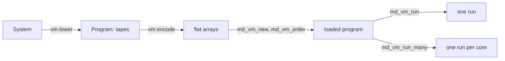
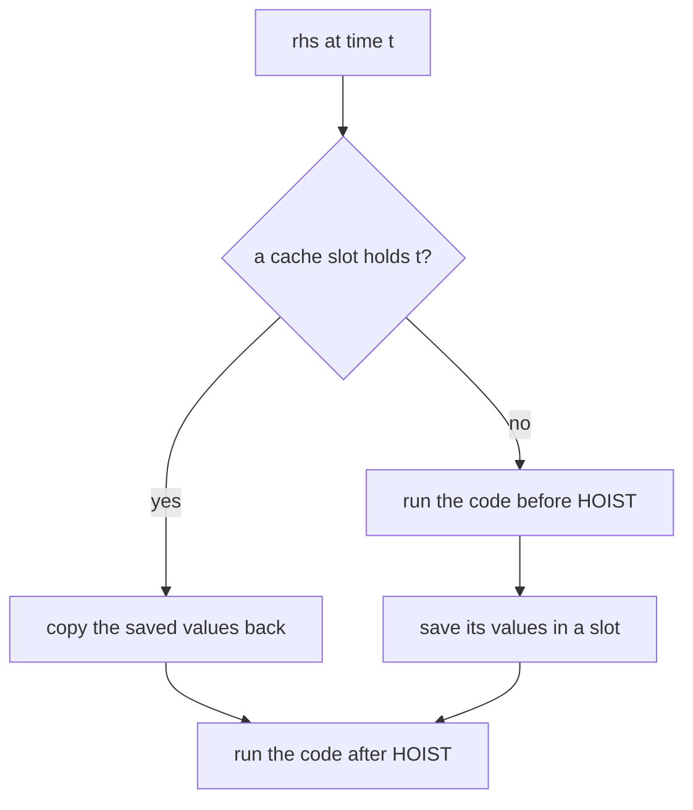

# How the engine's virtual machine works

This page describes the virtual machine inside the precompiled engine: the tape format, the
lowering passes, and what the engine does at run time. Read it before you change
`src/modelica/sim/vm.py` or `engine/src/lib.rs`. To use the engine, read
[The precompiled engine](engine.md).

The engine is built once and ships in the wheel. A model arrives as data (a tape) and the engine
interprets it. Nothing is compiled when a simulation runs.

The engine's Radau code (`engine/src/radau.rs`) is generated from `rust_radau.py` by
`vm.write_runtime()`. Edit the Python strings, then regenerate; `tests/test_vm.py` fails on a
stale copy.

## The pipeline

1. `vm.lower(system)` turns a causalized `System` into a `vm.Program`.
2. `vm.encode(program)` packs it into flat integer and float arrays.
3. `engine.load` passes the arrays to `md_vm_new`, which checks every register and constant
   index and refuses a bad program. `md_vm_order` hands over `Program.order` (from
   `bandwidth_order` on mode 0) and refuses a list that is not a permutation.
4. `md_vm_run` integrates one parameter vector. `md_vm_run_many` integrates many on `threads`
   threads (0: one per core, never more than the number of vectors), each on its own clone of
   the program.

## The tape

A `Program` holds one `Function` per kernel and mode: `rhs`, `jacobian`, `observe`,
`indicators`, `transition_prefix`, `transition`, plus `parameters`, `initial` and `latch`.

A `Function` is straight-line code, a tuple of `Instr(op, dst, a, b, c)`, plus its Newton
blocks. Operands are register numbers unless the opcode says otherwise.

| Opcodes | What they do |
|---|---|
| `CONST`, `TIME`, `LOAD_Y`, `LOAD_P`, `LOAD_W` | read a constant, `t`, a state, a parameter, a workspace slot |
| `STORE_OUT`, `STORE_W`, `COPY_Y_OUT`, `CLEAR_OUT` | write outputs and the workspace |
| `MOVE`, `ADD` ... `POW`, `NEG`, `NOT`, comparisons, `AND`, `OR` | arithmetic and logic |
| `CALL1`, `CALL2` | a builtin (`c` names it: `sin`, `exp`, `atan2`, ...) |
| `SELECT` | `dst = a != 0 ? b : c` |
| `SOLVE` | dense LU with partial pivoting over contiguous registers (not Radau's banded LU) |
| `NEWTON` | body, solve, add the step; stop when `max abs(step) < 1e-12` or after 50 rounds |
| `HOIST` | marker: everything before it reads only `time` and constants |
| `VGATHER`, `VSCATTER` | copy registers named in the function's `tables` into or out of a run |
| `VBROADCAST`, `VADD`, `VSUB`, `VMUL`, `VDIV`, `VNEG`, `VCALL1` | elementwise over runs of `n` consecutive registers |

The constants live in the last registers. The engine sets them once at load time, so the tape
has no `CONST` instruction for a constant read as a single operand.

## Lowering passes

`vm.lower` runs these passes in order. Each one keeps every result bit for bit.

| Pass | What it does |
|---|---|
| `_fold` | folds constant subexpressions; `_peephole` reads `MOVE` copies through and turns `x + (-y)` into `x - y` (not in a function with Newton blocks); `_prune` drops what nothing reads |
| `_preload` | constants are read from their fixed registers, with no `CONST` instruction |
| `_hoist` | in `rhs`, `jacobian`, `observe` and `indicators`: moves the instructions that read only `time` and constants before a `HOIST` marker, when there are at least 4 |
| `_compact` | numbers registers in the order `rhs` first uses them |

Every pass keeps these invariants:

- A register number never holds a second value. `_compact` renumbers; it does not reuse.
- A range that a `SOLVE` or a Newton block reads stays contiguous and moves as one.
- A `transition` branch keeps reading the registers its `transition_prefix` wrote.
- `_peephole` and `_hoist` touch only registers written once in the function.

What the passes do to the `rhs` tape of some example models:

| Model | States | `rhs` instructions before, after | Registers before, after |
|---|---|---|---|
| RCCircuit | 1 | 17, 14 | 76, 40 |
| BouncingBall | 2 | 8, 5 | 36, 20 |
| RLCCircuit | 2 | 25, 20 | 101, 52 |
| DCMotor | 3 | 45, 31 | 199, 102 |
| TorusHeat | 64 | 579, 513 | 1778, 1318 |

`_hoist` pays on a model with many terms that depend on `time` alone, such as a signal source
built from many sines. No example model reaches the threshold of 4, so none has a `HOIST`.

`bandwidth_order` picks the state order Radau factors in (reverse Cuthill-McKee on
`Mode.sparsity`). On WaveString the bandwidth drops from 9 to 2, on TorusHeat from 56 to 15.

The `jacobian` tape is built from `rhs` by forward mode (`_Tangents`). It computes one partial per
structural non-zero and writes them into a dense row-major `n x n` output, zeroed by one
`CLEAR_OUT`.

## At run time

One call of a function with a `HOIST` (`Program::enter`):

- `Program::run` reads registers without bounds checks. `md_vm_new` checked them all.
- A function with a `HOIST` keeps 4 cache slots of its time-only values, keyed by exact `t`
  equality and replaced in turn. Radau calls `rhs` at its three stage times in turn, then at the
  step start. A slot saves only the registers the code after `HOIST` reads.
- Radau builds `mu/h I - J` in the state order. The LU finds the band in the matrix and its
  loops stop there. Row swaps move only the part right of the pivot, as LAPACK's `gbtrf` does.
- The register file and the solve buffers live in a `Scratch` per program copy, so a call
  allocates nothing and threads share nothing.

## Encoding

`vm.encode` writes four arrays, which `md_vm_new` reads with fixed row widths (`lib.rs`):

- `code`: 5 integers per instruction (`op, dst, a, b, c`).
- `functions`: 4 per function (first instruction, count, first Newton block, block count).
- `newton`: 7 per block (first unknown, count, body start, body length, matrix, right, step).
- `unknowns`: the Newton blocks' unknowns and every function's gather `tables`; a `VGATHER` or
  `VSCATTER` names its table by offset in this array.
- `constants`: the float pool, loaded into the last registers.

Function index order: `rhs` per mode, `observe`, `indicators`, `transition_prefix`,
`jacobian`, then every `transition` branch, then `parameters`, `initial`, `latch`.

## Adding an opcode

Change all of these together. The engine matches raw numbers, so the two sides agree by hand.

1. `vm.Op`: the number. Add it to `_PURE` or `_REMOVABLE` when it writes `dst` from registers
   only, and to `_FIELDS` with the fields that name registers.
2. `vm.py`: `_operands`, `_apply`, `_reads`, `_writes`, ranges included.
3. `_Tangents.step`: its derivative rule. Without it the jacobian is wrong, with no error.
4. `_Machine._run`: the Python evaluator the tests compare the engine with.
5. `lib.rs`: `valid` (else `md_vm_new` refuses the program), `Program::run`, and `reads` and
   `writes` (else the time cache saves the wrong registers).
6. For an array opcode also `_array_reads`, `_array_writes`, `_array_runs` and `_FIELDS`, so
   `_compact` keeps its runs contiguous and renumbers its table.

## Speed

Time for one run of each example over its own `stop` and tolerance, on one core:

| Model | SciPy (`backend="python"`) | Engine |
|---|---|---|
| RLCCircuit | 0.41 s | 0.01 s |
| DCMotor | 0.87 s | 0.01 s |
| BouncingBall (6 events) | 0.03 s | under 0.01 s |
| Thermostat (33 events) | 0.69 s | 0.01 s |
| VanDerPol | 79.8 s | 0.21 s |
| TorusHeat (64 states) | 0.42 s | 0.11 s |

16 VanDerPol runs at different parameters take 0.57 s one after the other and 0.08 s with
`md_vm_run_many` on 16 logical cores.

Measured at version 0.0.231 on Linux x86_64 with 16 logical cores: process time for one run,
wall time for the 16 runs. The pass table above is from `vm.lower` at the same version.

## Where the design is

- [The VM note](issues/08-11-2026-a-modelica-vm-runs-the-model-as-bytecode-in-a-precompiled-rust-engine.md): why a VM, the first plan.
- [The simulation IR note](issues/09-11-2026-a-simulation-ir-with-arrays-events-and-parallel-execution-for-the-engine.md): arrays, events, parallel runs, and the measurements behind each step.
