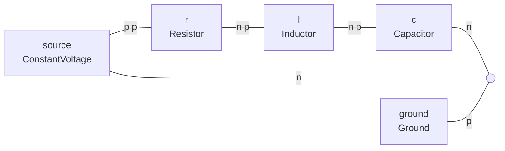

# modelica

A Modelica toolchain for Python. It reads Modelica source, flattens it to a DAE, simulates
it, and draws it.

The front end (parser, flattener, causalization) is Python. Simulation runs on a
[precompiled engine](engine.md): a virtual machine in Rust that ships in the platform wheels
and interprets the model as bytecode, with nothing compiled per model. Without an engine
wheel, simulation uses SciPy.

```bash
pip install modelica
```

It brings NumPy and SciPy. Python 3.12 or later.

!!! note "Status: 0.1"
    Parsing, flattening, causalization, simulation and diagrams are tested, and give the same
    numbers on the engine and on SciPy. The API can still change. `modelica.fmi`,
    `modelica.ssp` and the modules not exported from `modelica.sim` are experimental.

## The layers

| Module | What it does |
| --- | --- |
| `modelica.lang` | Modelica source to tokens to an AST |
| `modelica.build` | Python classes to the same AST values |
| `modelica.ir` | AST to a flat model, then matching, BLT sorting and index reduction |
| `modelica.sim` | Simulation on the engine or SciPy, with events |
| `modelica.diagram` | Any stage to a picture: SVG, Graphviz or Mermaid |
| `modelica.fmi` | FMI 3.0: `modelDescription.xml` and the calling sequence (experimental) |
| `modelica.ssp` | SSP 2.0: the co-simulation master protocol (experimental) |

Start with [Architecture](architecture.md) for the data model and the build order.

## See a model first

A Modelica model is a graph, and the fastest way to understand one is to look at it.

```python
from modelica import diagram

diagram.of("examples/models/RLCCircuit.mo", "examples/library/Electrical.mo")
```



The three connectors that meet at the bottom are one junction, and not three separate
lines. That is what the flattener makes of them: one sum of currents, taken once.

[Drawing a model](notebooks/drawing.ipynb) shows the other two pictures — equations against
variables, and blocks in the order the solver runs them.

## Notebooks

Every notebook here is executed when this site is built. What you read is what the current
code does. The `.ipynb` pages carry figures and sliders, and they are meant to be opened.

| Page | What it shows |
| --- | --- |
| [Simulating a model](notebooks/simulating.py) | Source to AST to flat model to system to code to trajectory, stopping at each stage |
| [Drawing a model](notebooks/drawing.ipynb) | The three pictures of one model, and what each one is for |
| [Turning the knobs](notebooks/exploring.ipynb) | A parameter study as a `for` loop over copies of the flat model, then the same thing on sliders |
| [The shape of the equations](notebooks/structure.ipynb) | Incidence matrices, what alias elimination removes, and the BLT staircase |
| [Where the smoothness breaks](notebooks/events.ipynb) | Bounce events, the step size collapsing into them, and the pendulum changing state sets |
| [Roasting a batch](notebooks/roasting.ipynb) | A model of a real machine, checked against what the machine recorded |
| [Enumerating the discrete half](notebooks/verifying.py) | Model checking of the event iteration, state selection, FMI modes and the co-simulation master |

The `.ipynb` pages read their models from `examples/`, so you need a checkout to run them:

```bash
git clone https://gitlab.com/jorgeecardona/pymodelica && cd pymodelica
pip install modelica matplotlib ipywidgets
jupyter lab docs/notebooks/
```

## Standards

* **Modelica Language Specification 3.x**
* **FMI 3.0** — [fmi-standard.org](https://fmi-standard.org/)
* **SSP 2.0** — [ssp-standard.org](https://ssp-standard.org/)

## How these pages are written

They follow ASD-STE100 Simplified Technical English. [The style page](style.md) lists the
rules and the two places this project departs from them.

## Trademarks

Modelica® is a registered trademark of the [Modelica Association](https://modelica.org/).
FMI and SSP are also its trademarks. These pages use the names to identify the language
this software reads and the standards it implements.

This project is **not affiliated with the Modelica Association, and the Association does
not sponsor or endorse it.** It is an independent open-source implementation. The language,
its specification and the Modelica Standard Library are at
[modelica.org](https://modelica.org/).
