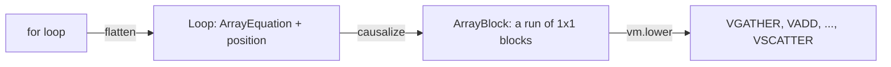

# Array models

A grid model writes one equation per cell in a `for` loop. This page follows such a loop from
the source to the array opcodes the engine runs, using TorusHeat, the heat equation on an
8 x 8 periodic grid.

```modelica
for i in 1:n loop
  for j in 1:n loop
    der(T[i, j]) = a * (T[mod(i - 2, n) + 1, j] + T[mod(i, n) + 1, j]
                      + T[i, mod(j - 2, n) + 1] + T[i, mod(j, n) + 1] - 4 * T[i, j]);
  end for;
end for;
```



## Flatten: `ArrayEquation`

`flatten` carries the loop body once with `i` and `j` left as names, then fills in each cell.
The scalar equations come out as before, and `FlatModel.loops` keeps the loop beside them:

- `IndexSet("i", 1, 8)`, `IndexSet("j", 1, 8)`: the ranges.
- the body, with each array read an `ir.Subscript` over the index names.
- `constants`: the integer parameters an index reads, here `n = 8`.

An index is evaluated at every cell and range checked. `mod(i - 2, n) + 1` is the periodic
neighbour because the source says so; `x[i + 1]` at the last cell is an error naming the cell,
never a silent wrap.

## Causalize: `ArrayBlock`

When every cell becomes its own explicit 1x1 block, in cell order, the mode records an
`ArrayBlock(first, equation)`: `Mode.blocks[first:first + 64]` came from the loop.
`Mode.blocks` itself does not change, so every other consumer still sees scalar blocks.

For now this needs a model with one mode, no eliminated alias and no index reduction, because
only then does each equation keep its flattened position.

## Lower: shaped opcodes over views

`vm.lower` writes the right-hand side once over all 64 cells, with shaped opcodes. A shaped
opcode names *views*: a view is a base register, a shape and strides (`vm.View`, NumPy's
strided model). TorusHeat's `rhs` (`vm.listing`; a view prints as `r1[8x8:8,1]`, base, shape
and strides):

```text
   0  r0 = p[1]
   1  r1[64] = y[0:64]
   2  r130[8x8:8,1] = roll(r1[8x8:8,1], 1, axis=0)
   3  r194[8x8:8,1] = roll(r1[8x8:8,1], -1, axis=0)
   4  r258[8x8:8,1] = r130[8x8:8,1] + r194[8x8:8,1]
   5  r322[8x8:8,1] = roll(r1[8x8:8,1], 1, axis=1)
   6  r386[8x8:8,1] = r258[8x8:8,1] + r322[8x8:8,1]
   7  r450[8x8:8,1] = roll(r1[8x8:8,1], -1, axis=1)
   8  r514[8x8:8,1] = r386[8x8:8,1] + r450[8x8:8,1]
   9  r65 = 4.0
  10  r578[8x8:8,1] = r65 * r1[8x8:8,1]
  11  r642[8x8:8,1] = r514[8x8:8,1] - r578[8x8:8,1]
  12  r66[8x8:8,1] = r0 * r642[8x8:8,1]
  13  out[0:64] = r66[64]
```

Each subscript is classified by its values over the loop variables:

- `T[i + k, j]` or a constant index is a view of the array's block: a slice, or a transpose
  when the axes come in another order. No instruction.
- `T[mod(i + k - 1, n) + 1, j]` over the whole axis is a view and a `ROLL`.
- `T[max(i - 1, 1), j]` or `T[min(i + 1, n), j]` over the whole axis is a view and a `SHIFT`:
  the edge cell reads itself.
- Anything else is a `VGATHER` into a fresh block.

A part that does not vary (`a`, `4.0`) is computed once and read through a view with stride 0.
Every scalar operator is `TBINARY`, an `if` is `TSELECT`, `max`, `min` and `mod` are `TCALL2`,
and a loop index used as a value is `TINDEX`. A relation that generates events reads each
cell's latch, as the scalar tape does. The result block's registers name the cells, so no
scatter is needed.

Each cell does the same operations in the same order as its scalar block, so the result is the
same bits; tests compare the trajectories. A loop whose scalar blocks are not the loop body at
each cell (after the same `simplify` that `causalize` applied) is written with the flat array
opcodes below, or as scalar blocks.

| TorusHeat 8 x 8 | `rhs` | gather-table entries | `jacobian` |
|---|---|---|---|
| scalar blocks (`arrays=False`) | 513 | 0 | 1090 |
| flat array opcodes (`shaped=False`) | 18 | 384 | 33 |
| shaped opcodes (default) | 14 | 0 | 31 |

## The jacobian

The jacobian tape is built from the shaped `rhs` by forward mode. The partials of a block are
*runs*: one block of values per pattern, keyed by the state each cell reads. A `ROLL` or a view
regroups them; `TBINARY` with `+`, `-`, `*`, `/` combines them. Where two patterns name one
state in one cell (a clamped read at a face), the partials are added in that cell.

The stores go last, ordered by source register, so one pattern's values are one
`VSTORE_OUT`; `Program.pattern` lists the entries in that order. TorusHeat's five offsets are
one `VSTORE_OUT` of 320 values. `^`, an `if`, a builtin of something with partials, or a
reduction falls back to a jacobian from scalar blocks.

## The flat array opcodes

`shaped=False` writes a loop with the flat opcodes over runs of registers: one `VGATHER`
through a table per subscript, `VADD`, `VMUL` and the others elementwise, and a `VSCATTER` into
one register per cell. The mesh tapes (`modelica.sim.fv`, `modelica.sim.fem`) use these, with
`VSCATTER_ADD` for the face sums.
