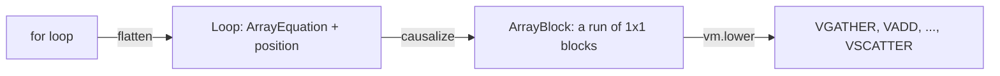

# Array models

A grid model writes one equation per cell in a `for` loop. This page follows such a loop from
the source to the array opcodes the engine runs, using TorusHeat, the heat equation on an
8 x 8 periodic grid.

```modelica
for i in 1:n loop
  for j in 1:n loop
    der(T[i, j]) = a * (T[mod(i - 2, n) + 1, j] + T[mod(i, n) + 1, j]
                      + T[i, mod(j - 2, n) + 1] + T[i, mod(j, n) + 1] - 4 * T[i, j]);
  end for;
end for;
```



## Flatten: `ArrayEquation`

`flatten` carries the loop body once with `i` and `j` left as names, then fills in each cell.
The scalar equations come out as before, and `FlatModel.loops` keeps the loop beside them:

- `IndexSet("i", 1, 8)`, `IndexSet("j", 1, 8)`: the ranges.
- the body, with each array read an `ir.Subscript` over the index names.
- `constants`: the integer parameters an index reads, here `n = 8`.

An index is evaluated at every cell and range checked. `mod(i - 2, n) + 1` is the periodic
neighbour because the source says so; `x[i + 1]` at the last cell is an error naming the cell,
never a silent wrap.

## Causalize: `ArrayBlock`

When every cell becomes its own explicit 1x1 block, in cell order, the mode records an
`ArrayBlock(first, equation)`: `Mode.blocks[first:first + 64]` came from the loop.
`Mode.blocks` itself does not change, so every other consumer still sees scalar blocks.

For now this needs a model with one mode, no eliminated alias and no index reduction, because
only then does each equation keep its flattened position.

## Lower: array opcodes

`vm.lower` writes the right-hand side once over all 64 cells. TorusHeat's `rhs`, the array
part (`vm.listing`, tables cut after 8 entries):

```text
  64  r64 = y[63]
  65  r65[64] = r0
  66  r129[64] = gather r[57, 58, 59, 60, 61, 62, 63, 64, ...]
  67  r193[64] = gather r[9, 10, 11, 12, 13, 14, 15, 16, ...]
  68  r257[64] = r129[64] + r193[64]
  69  r321[64] = gather r[8, 1, 2, 3, 4, 5, 6, 7, ...]
  70  r385[64] = r257[64] + r321[64]
  71  r449[64] = gather r[2, 3, 4, 5, 6, 7, 8, 1, ...]
  72  r513[64] = r385[64] + r449[64]
  73  r577 = 4.0
  74  r578[64] = r577
  75  r642[64] = gather r[1, 2, 3, 4, 5, 6, 7, 8, ...]
  76  r706[64] = r578[64] * r642[64]
  77  r770[64] = r513[64] - r706[64]
  78  r834[64] = r65[64] * r770[64]
  79  scatter r834[64] into r[898, 899, 900, 901, 902, 903, 904, 905, ...]
  80  out[0] = r898
```

- Each subscript is one `VGATHER` through a table of state registers. The table holds the
  periodic wrap; the opcode is a plain gather.
- A part with no subscript (`a`, `4.0`) is computed once and broadcast.
- The `VSCATTER` gives each cell's derivative its own register, as a scalar block would.

Each cell does the same operations in the same order as its scalar block, so the result is the
same bits; a test compares the trajectories. Anything the array path cannot write falls back to
scalar blocks for that loop: an `if`, a comparison, `^`, a two-argument call (`max`, `mod`), a
loop index used as a value, or a loop whose first or last block is not the body at that cell.

| Grid | Scalar `rhs` | With array opcodes |
|---|---|---|
| 8 x 8 | 513 instructions | 144 |
| 50 x 50 | 20001 instructions | 5016 |

Most of what is left is one state load and one output store per cell. The jacobian is still
built from the scalar `rhs`.
