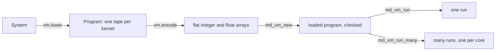

# The virtual machine

This section explains the virtual machine (VM) that runs simulations in the precompiled engine.
Read it before you change `src/modelica/sim/vm.py` or `engine/src/lib.rs`. To run a model,
read [The precompiled engine](../engine.md) instead.

The engine is built once and ships in the platform wheels. A model reaches it as data, a
*tape* of instructions, and the engine interprets that tape inside its Radau integrator.
Nothing is compiled when a simulation runs.

## Pages

| Page | What it covers |
|---|---|
| [The tape](tape.md) | Registers, constants, every opcode, and how to read a tape |
| [Lowering](lowering.md) | How `vm.lower` writes the tapes, its passes and their invariants |
| [Array models](arrays.md) | How a `for` loop becomes array opcodes |
| [At run time](runtime.md) | What the engine checks and caches, Radau, parallel runs |
| [Changing the VM](extending.md) | The encoding, and every place an opcode lives |

## Speed

Time for one run of each example over its own `stop` and tolerance, on one core:

| Model | SciPy (`backend="python"`) | Engine |
|---|---|---|
| RLCCircuit | 0.41 s | 0.01 s |
| DCMotor | 0.87 s | 0.01 s |
| BouncingBall (6 events) | 0.03 s | under 0.01 s |
| Thermostat (33 events) | 0.69 s | 0.01 s |
| VanDerPol | 79.8 s | 0.21 s |
| TorusHeat (64 states) | 0.42 s | 0.11 s |

16 VanDerPol runs at different parameters take 0.57 s one after the other and 0.08 s with
`md_vm_run_many` on 16 logical cores. Measured at version 0.0.231 on Linux x86_64: process time
for one run, wall time for the 16 runs.

## Where the design is

- [The VM note](../issues/08-11-2026-a-modelica-vm-runs-the-model-as-bytecode-in-a-precompiled-rust-engine.md): why a VM.
- [The simulation IR note](../issues/09-11-2026-a-simulation-ir-with-arrays-events-and-parallel-execution-for-the-engine.md): the plan, with the measurement behind each step.
- [What to take from OpenFOAM](../issues/09-11-2026-what-the-engine-can-take-from-openfoam-for-finite-volume-pdes.md): finite volume and finite element models.
