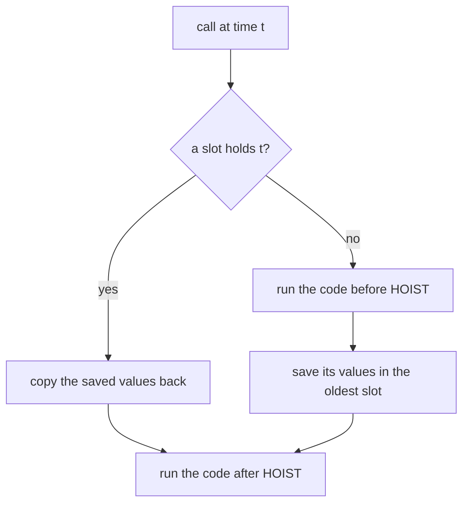

# At run time

This page covers what the engine does with a loaded program: the checks, the run loop, the
caches, the integrator and parallel runs.

## Loading

`engine.load` passes the encoded arrays to `md_vm_new`, which refuses the program (null) if any
instruction names a register outside the file, a constant outside the pool, a run past the end,
a table entry that is not a register, or a Newton block that does not exist. `md_vm_order` then
hands over the state order and refuses a list that is not a permutation.

Because of these checks, `Program::run` reads registers without bounds checks.

## One call

`Program::run` walks the instructions and dispatches on the opcode. The register file, the
solve buffers and the caches live in a `Scratch` per program copy, so a call allocates nothing.

A function with a `HOIST` keeps 4 cache slots of its time-only values, keyed by exact `t`.
Radau's Newton iteration calls `rhs` at the same three stage times on every round of a step,
and once at the step start, so from the second round on every call hits a slot. A miss
replaces the oldest slot.

A slot saves only the registers the code after `HOIST` reads, so another function that writes
the same registers (the jacobian repeats the `rhs` instructions) does no harm.

## Radau

The engine runs the same Radau IIA (order 5) integrator as the Rust backend, with events. Its
code (`engine/src/radau.rs`) is generated from `rust_radau.py` by `vm.write_runtime()`. Edit
the Python strings, then run
`uv run python -c "from modelica.sim import vm; vm.write_runtime()"`; `tests/test_vm.py`
fails while the file is out of date.

Radau factors `mu/h I - J` with rows and columns in the program's state order. The LU finds the
band in the matrix and stops its loops there. Row swaps move only the part right of the pivot,
as LAPACK's `gbtrf` does, so the solves stay inside the band too. A model in a good order
factors in `n * lower * (lower + upper)` instead of `n^3 / 3`.

The jacobian tape writes one value per nonzero, in the order of `Program.pattern`
(`md_vm_pattern`). Radau places each entry in band storage of width `2 lower + upper + 1`
in the state order, so memory grows with `n` times the band, not `n * n`.

`Program.mass` (`md_vm_mass`) gives a diagonal mass matrix: Radau then solves `M y' = f`,
factoring `mu/h M - J`. A row with mass 0 is algebraic, so an index-1 DAE runs.

A time event is a `when time >= v` branch whose `v` is a discrete variable, which is what
`when sample(start, interval)` flattens to. `Program.times` gives each event's workspace slot of
`v` (-1 for a state event), set with `md_vm_times`. Radau cuts each step at the earliest `v`
ahead and fires the event at that instant exactly, with no root search and no rearm nudge. One
due at the step's start fires there. At one instant the event iteration also fires every other
time event that is due, then every stale latch. SciPy does the same: `_next_time` ends the
segment, and `_stale` reports a due time event first.

## Parallel runs

`md_vm_run_many` integrates many parameter vectors. It starts `threads` threads (0: one per
core, never more than the number of vectors), each on its own clone of the program, so threads
share nothing. A sweep (`modelica.sim.sweep`) uses it for more than one vector. The results
are bit for bit those of single runs.
